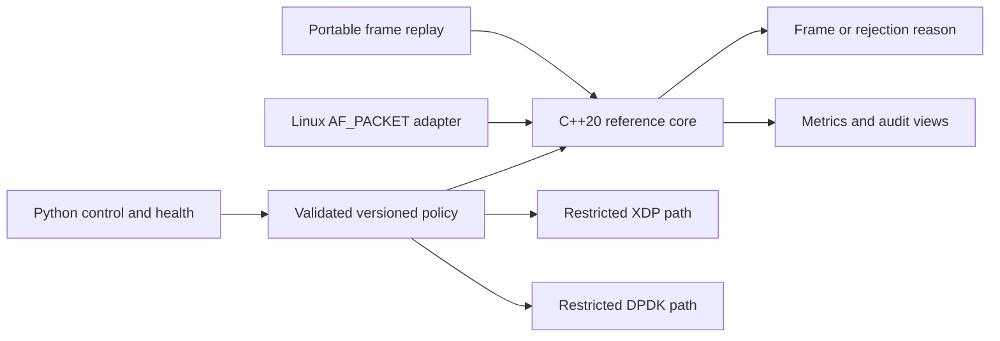

# NetForge

[](https://github.com/UtkarshAlshi/netforge/actions/workflows/ci.yml)


**A programmable IPv4 dataplane with stateful NAT, load balancing, versioned control, and experimental XDP/DPDK backends.**

NetForge receives an Ethernet frame, validates it, applies a policy, and either
emits a rewritten frame or records why it was rejected. It implements this packet
path in C++20, then adds bounded worker ownership and a Python management plane.
The same reference core runs as a portable offline replay tool and a Linux
AF_PACKET appliance. You can demonstrate the portable version without Docker,
root access, network configuration, or a running service.

**Start here:** [Run the demo](#run-the-demo) · [How it works](docs/architecture.md) ·
[Verified results](docs/results.md) · [Full documentation](docs/README.md)

## What it demonstrates

- **Packet processing:** Ethernet/IPv4 validation, longest-prefix routing, ordered
  ACLs, TTL/MTU handling, checksums, ARP and related ICMP translation.
- **Stateful services:** UDP/TCP tracking, SNAT/PAT, virtual service translation,
  round robin, weighted round robin, least-connections, rendezvous hashing and draining.
- **Concurrency:** one or two state owners, bounded queues, disjoint PAT ranges,
  reverse-flow affinity, expiry and transactional configuration reload.
- **Management:** authenticated HTTP, optional mutual TLS, configuration generation
  ACK/rejection, bounded audit, health hysteresis and journaled fleet reconciliation.
- **Recovery and diagnostics:** durable configuration checkpoints, exact-child
  crash recovery, process/socket/rule/backend/health metrics and saved HTML views.
- **Backend integration:** restricted XDP routing/filtering and real DPDK ring,
  PCAP and AF_PACKET PMD paths, with byte-parity and ownership/cleanup checks.

The reference backend provides the broadest stateful feature set. XDP and DPDK
have explicit restricted contracts; they are not interchangeable full firewalls.
This is an isolated-lab systems engineering project, not a production appliance
or a claim of physical-NIC line rate. [Capabilities and limits →](docs/capabilities.md)

## Run the demo

Demo prerequisites: **a C++20 compiler and Python3.9+**. CMake is optional for
the demo: it falls back to a serial direct compiler build when CMake is missing.
Full verification needs CMake3.20+, Make/Ninja, Python3.10+ and OpenSSL CLI.
See [installation checks](docs/getting-started.md) if these are not installed.

```sh
git clone https://github.com/UtkarshAlshi/netforge.git
cd netforge
python3 tools/demo.py --output ../netforge-demo
```

The launcher checks prerequisites before creating output, builds only the reference executable serially, and verifies five
small packet scenarios. It creates a new sibling directory and prints the path
to **`../netforge-demo/packets/index.html`**. Open that file in any browser; on
macOS you can run:

```sh
open ../netforge-demo/packets/index.html
```

The walkthrough shows input/output tuples and TTL, decision reasons, raw frame
hex, generated JSON and source/executable hashes. Expected outcomes:

| Scenario | Result you can explain |
|---|---|
| Routing | TTL64 becomes63; Ethernet next-hop addresses change |
| Source NAT | Client source becomes `10.77.0.254:40000` |
| Load balancing | Three packets select A, B, A; the first flow stays pinned |
| TTL expiry | TTL1 produces ICMP Time Exceeded |
| Malformed input | A one-byte Ethernet frame is rejected without emission |

These are verified **offline packet transformations**, not live traffic or a
performance benchmark. Use a new output path to repeat the demo; existing output
is never overwritten. [Five-minute presentation script →](docs/demo.md)

## Build, test and inspect

From the repository root:

```sh
python3 tools/verify.py --sanitizers --output ../netforge-verification
```

This serially builds, runs CTest and documentation/provisioning checks, verifies
the source archive, and generates the demo. It installs nothing, starts no
persistent service and changes no interface. Some tests use short-lived loopback
HTTP/TLS servers. Output includes `report.json`, build/test
logs, the source archive, and `demo/index.html`.

To inspect a configuration or replay generated frames using the demo build:

```sh
../netforge-demo/build/netforge --version
../netforge-demo/build/netforge check examples/appliance.conf
../netforge-demo/build/netforge replay examples/appliance.conf lan ../netforge-demo/packets/service.hex
```

JSON packet decisions go to stdout; metrics go to stderr. For Linux live traffic,
use dedicated isolated interfaces and the separate [live-lab guide](docs/live-lab.md).
Do not run the raw-packet backend on your workstation's normal network interface.

## Verified results

The portable0.1.0 release passed Linux/macOS sanitizer checks and fresh-container
live integration. Retained results are [committed here](results/portable-0.1.0/README.md).

| Evidence | Observed outcome | Boundary |
|---|---|---|
| Counterbalanced reference/DPDK network experiment |48 trials;3,072/3,072 packets verified;0 missing | Private veths, shared0.5CPU/512MiB cap; includes generator/capture overhead |
| DPDK ownership pressure |7 sent,9 unsent; all255 mbufs reclaimed | Forced partial TX in ring PMD |
| DPDK live forwarding |64/128/512/1514-byte output matches reference | AF_PACKET PMD on private veths |
| Control/fault acceptance | Reload/rejection, health recovery, supervisor crash recovery and real mTLS publication passed | Isolated Linux processes; restarts lose flows |
| Worker scaling experiment | No demonstrated speedup under the CPU cap | Historical24-trial offline result; not multicore hardware scaling |

There is no physical-NIC throughput, production latency, seamless failover or
research-novelty claim. Hardware/NUMA/PMU and4–8-core studies are deferred.
[Methods, provenance and limitations →](docs/results.md)

## Architecture at a glance



[Detailed architecture](docs/architecture.md) explains the state lifecycle,
worker ownership, reload boundary and recovery guarantees.

## Repository map

| Path | Contents |
|---|---|
| `src/`, `include/netforge/` | C++ packet engine, configuration and worker runtime |
| `control/` | Authenticated supervisors, durable recovery, fleet and health tools |
| `backends/xdp/`, `backends/dpdk/` | Optional restricted backend implementations |
| `examples/` | Synthetic, validated example policies |
| `tests/` | Parser, engine, state, control, backend and fault tests |
| `tools/` | Demo, verification, packaging, metrics and isolated lab tools |
| `docs/` | Setup, demonstration, design, operations and current reference |
| `results/` | Small sanitized reports and raw benchmark observations |
| `docs/archive/` | Historical milestones and development evidence; not setup instructions |

## Further reading

- [Documentation index](docs/README.md) — choose a reading path.
- [Configuration reference](docs/reference/configuration.md) — grammar and policy semantics.
- [Security and threat model](SECURITY.md) — privileges and trust boundaries.
- [Interview/resume guide](docs/portfolio.md) — factual bullets and design questions.
- [Contributing](CONTRIBUTING.md) · [Changelog](CHANGELOG.md) · [MIT license](LICENSE).
