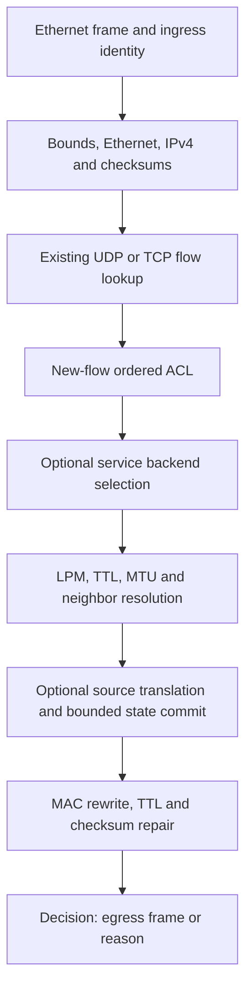

# How NetForge works

## Problem and separation of concerns

Routers and load balancers decide how a packet should move, but real packet I/O,
policy, connection state and configuration recovery have different correctness
requirements. NetForge separates these concerns so that the same packet decisions
can be tested without network privileges and then exercised on isolated Linux
interfaces. It is an IPv4 systems project rather than a general HTTP proxy.

ARP ownership and local ICMP handling branch from the normal transit path. A
missing dynamic neighbor can defer a frame in a bounded queue; maintenance sends
limited ARP requests and reprocesses it. This is why engine calls, socket packets
and final emissions are separately counted.

## Code map

| Component | Code | Responsibility |
|---|---|---|
| Parsers/checksums | `src/ethernet.cpp`, `src/ipv4.cpp`, `src/tcp.cpp` | Validate before accessing packet fields |
| Policy/config | `src/config.cpp`, `src/scheduler.cpp` | Validate a full generation; route/ACL/backend selection |
| Reference engine | `src/appliance.cpp` | Translation, state, ARP/ICMP, expiration and reason-coded decisions |
| I/O and concurrency | `src/linux_io.cpp`, `src/workers.cpp` | Linux sockets, bounded work and worker ownership |
| Management | `control/` | Process supervision, publication, recovery, health and fleet reconciliation |
| Optional backends | `backends/xdp/`, `backends/dpdk/` | Restricted stateless policy execution and owned lifecycle |

## State and ownership

A flow stores its original and translated tuples, protocol, ingress/egress,
timeouts and immutable configuration snapshot. Replies find the inverse mapping.
Existing flows retain their policy generation, backend and route; a reload affects
new flows. At most eight flow-pinned generations are retained. A deny-rule reload
is therefore not an immediate revocation of all established connections.

The reference engine owns its state on one thread. Worker mode partitions state
between one or two owners. Forward dispatch and reverse NAT-port affinity route
both directions to the same owner; PAT ranges do not overlap within a protocol.
Queues and batch sizes are bounded. Worker reload quiesces and stages all owners
before commit. It is not a general lock-free/RCU implementation or flow replication.

## Control path and recovery

An agent validates a candidate with the real executable, writes it atomically,
signals its child and waits for the matching publication/rejection event. A known
rejection restores the prior file; a lost ACK produces uncertainty rather than a
false rollback claim. Durable agents checkpoint acknowledged configuration and
revision high-water. Resume verifies process identity before an explicitly
requested pidfd stop of an orphan; a cold restart restores config, not flows.

Fleet rollout performs full-member preflight, durably records intent before POST
and reconciles exact generation/hash. An ambiguous intent is never blindly posted
again. Health decisions use failure/recovery hysteresis and stop on configuration
drift. mTLS remote nodes add certificate verification, bearer authorization and
explicit node identity to static membership. No consensus or automatic failover
is implemented.

## Backend and measurement boundaries

XDP compiles a restricted policy into a frozen map and conditionally replaces the
owned program. Its PASS action reaches the lab kernel, not the reference engine.
DPDK ring/PCAP processing checks mbuf ownership; the live AF_PACKET PMD service
uses PACKET_MMAP on dedicated veths. Neither backend implements reference NAT or
TCP tracking. See [the capability matrix](capabilities.md).

Core emitted bytes, successful socket/PMD sends, XDP decisions and observed
application delivery are different quantities. The [results](results.md) retain
those distinctions and do not convert private-veth observations into NIC claims.
